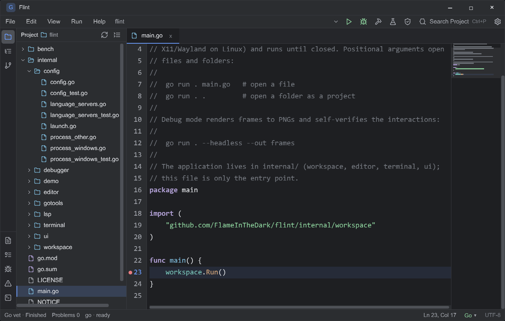

# Flint

**A desktop code editor for Windows and Linux, built in Go with [go-gpui](https://github.com/FlameInTheDark/go-gpui).**

[Releases](https://github.com/FlameInTheDark/flint/releases) · [Quick start](#quick-start) · [Shortcuts](#shortcuts) · [Development](#development)



## Features

- **Edit and navigate:** syntax highlighting, a project tree, project-wide search, a command palette, and a minimap.
- **Run and debug Go:** saved launch configurations, build and test commands, and breakpoint debugging with Delve.
- **Stay in the editor:** use the integrated terminal, preview CommonMark and GitHub Flavored Markdown, and review side-by-side Git diffs.

## Quick start

Look for prebuilt Windows or Linux archives on the [Releases page](https://github.com/FlameInTheDark/flint/releases), or run Flint from source with **Go 1.23 or later**. From the repository root:

```sh
go run .               # open the welcome screen
go run . main.go       # open a file
go run . .             # open the current folder as a project
```

Use `go build .` to build a binary. On Windows, use `go build -ldflags "-H windowsgui" .` to build a binary that opens without a console. No separate checkout of go-gpui is needed.

## Optional tools

| Install or add to `PATH` | What it enables |
| --- | --- |
| `go install golang.org/x/tools/gopls@latest` | Go completion (**Ctrl+Space**), go to definition (**Ctrl+click**), and documentation (**Ctrl+Q**). |
| `go install github.com/go-delve/delve/cmd/dlv@latest` | Go debugging with the **Debug** button or the **Run** menu. |
| `git` | View diffs and history, stage changes, commit, fetch, and push. |

## Shortcuts

| Action | Shortcut |
| --- | --- |
| Save the active file | **Ctrl+S** |
| Find in the active file | **Ctrl+F** |
| Find a project file | **Ctrl+P** |
| Search text across the project | **Ctrl+Shift+F** |
| Open the command palette | **Ctrl+Shift+P** |
| Run / stop a Go task | **Shift+F10** / **Ctrl+F2** |
| Start / stop debugging | **Shift+F9** / **Shift+F5** |
| Toggle a breakpoint | **F9** |

The **Run** and **Debug** buttons each switch to **Stop** while their task or session is active. Use the **Run** menu to debug package tests or manage launch configurations. On a Markdown tab, click **Preview** to switch from source to rendered Markdown.

## Git

Open **Git Version Control** in the tool rail.

- **Review:** Click a file in **Changes** to open its side-by-side diff, or switch to **History** for recent commits on the current branch.
- **Stage and commit:** Use the checkboxes to stage or unstage files, or click **Stage All**. In the message box, **Enter** inserts a newline; **Ctrl+Enter** or **Commit** commits only staged changes.
- **Fetch and push:** **Fetch** updates remote-tracking information without modifying local files. **Push** sends the current branch to its upstream; on a first push, Flint uses `origin` or the only configured remote and sets the upstream. **Commit & Push** keeps the local commit if the push fails.

Flint uses your Git configuration, credential helper, and SSH agent. Set up authentication outside Flint if needed. Flint does not force-push when a push is rejected.

## Settings

Flint reuses the former editor's settings and language-server configuration in `~/.go-gpui/editor`. Set `GO_GPUI_CONFIG_DIR` to use a different directory.

## Development

```sh
go test ./...
go run . --headless --out frames
go run ./bench -big 10000 -frames 1500 -cpuprofile frame-build.cpu
go test ./internal/workspace -run '^$' -bench '^BenchmarkSoftwarePaint$' -benchmem
```

The headless mode drives the editor without a display and writes PNGs. Terminal integration tests require `sh`; Windows terminal tests also exercise ConPTY.

If you're modifying both projects at once, keep them in sibling directories and create an optional local workspace from Flint:

```sh
go work init . ../go-gpui
```

Flint ignores workspace files. Set `GOWORK=off` to build against the published dependency, as CI does.

## Release process

Successful pushes to `main`, including merges, use semantic-release and [Conventional Commits](https://www.conventionalcommits.org/) to decide whether to tag and publish a release. The first release needs a release-triggering commit, such as `feat: launch Flint`.

After a release is published, the same workflow builds from the exact tag and attaches archives for **Linux and Windows** on **amd64 and arm64**, with SHA-256 checksums. macOS isn't packaged because go-gpui has no native macOS backend. If a packaging job fails after the release was created, rerun the failed jobs rather than starting a new release.

## License

Apache-2.0. See [LICENSE](LICENSE) and [NOTICE](NOTICE).
